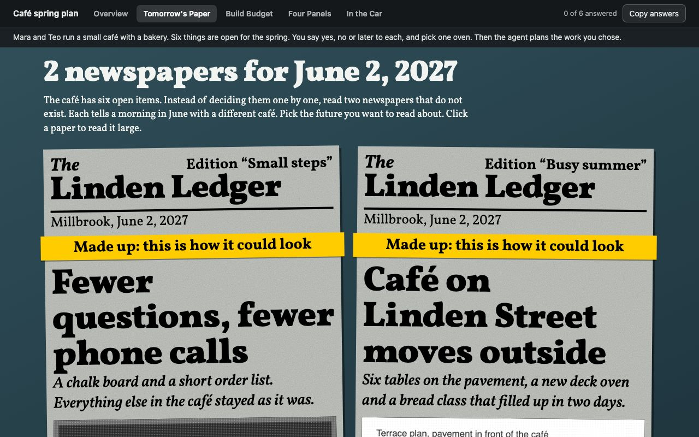
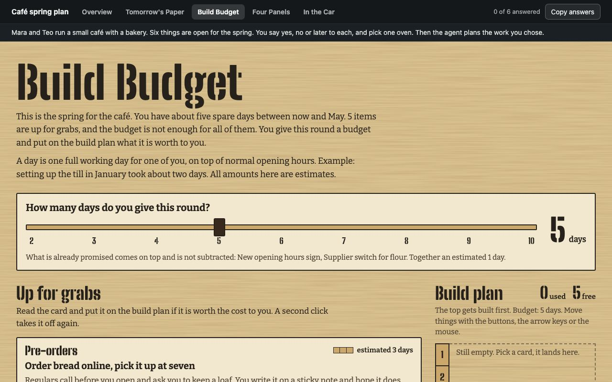
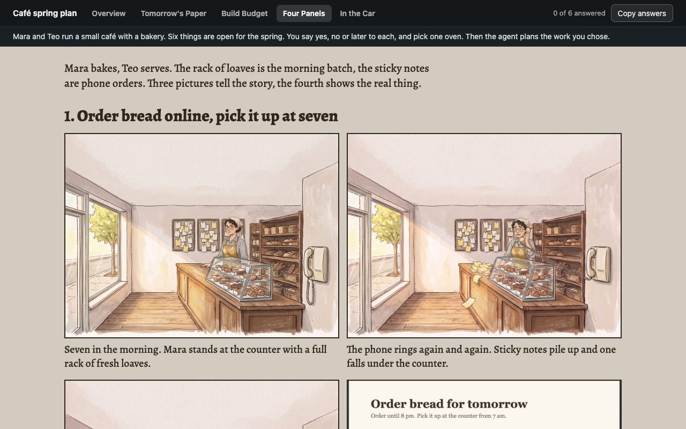
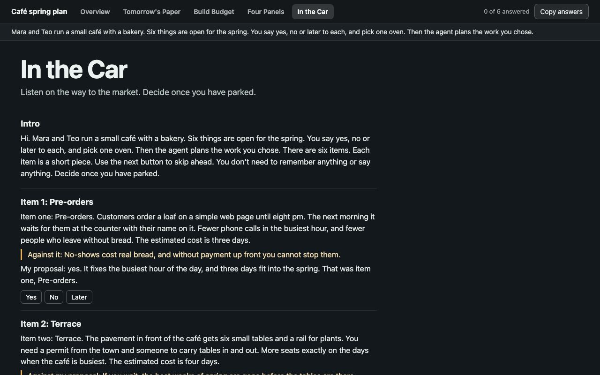

# decision-play

decision-play is a free, open-source Claude Code skill. It turns the open decisions of a session into one local page you answer on, instead of a wall of text in the chat. The page goes through the same decisions in four ways: Tomorrow's Paper, Build Budget, Four Panels and In the Car. When you are done, you copy one text and paste it back into the chat. Only that text counts. Clicks on the page are never approval.



## The four ways

Tomorrow's Paper gives you two or three made-up newspapers from the future. Each one tells a single day as if a certain set of choices had been made. There is also an optional "Nothing New" edition. You pick the future you want to read.


Build Budget is a game with a budget. Every item has an estimated cost in a unit the session picks, for example days or build nights. You set your budget with a slider and put items on a build plan, in order.



Four Panels turns each item into a four-panel story. Panel 1 shows today, panel 2 the snag, panel 3 the change. Those three are painted. Panel 4 is the real thing, a screenshot or a draft, and it is never painted.



In the Car is a script to listen to. It has an intro, one short piece per item and a closing. Each piece holds the explanation, a second voice with the counter argument, and the proposal. The skill writes the script and makes no audio. If audio files exist, the page plays them.



## Try the example

The folder `skills/decision-play/example/` holds a full example: an invented café run by two invented people, Mara and Teo. They have six spring decisions: pre-orders, a terrace, a menu board, a digital stamp card, a bread class and which oven. All four ways are filled in. The café, the people and all numbers are made up.

To try it without installing anything, open `skills/decision-play/example/index.html` in a browser.

The nine painted panels were made with Higgsfield (model nano_banana_2_1) from three reference sheets: two characters and one café without people. That took 15 images and 30 credits in total. The fourth panels are screenshots of small HTML drafts.

## The answer text

At the end, the page builds a text like this:

```
Café spring plan, my answers:
1 Pre-orders: yes
2 Terrace: later
6 Oven: Deck oven, best for bread
Still open: 3, 4, 5
Order: Pre-orders
How the ways felt: Tomorrow's Paper pleasant, Build Budget okay
```

- The first line is a title for the answers.
- Each answered item gets a line with its number, its name and your answer. An answer is yes, no, later, or the text of the option you chose, like the deck oven for item 6.
- "Still open" lists the numbers of the items you have not answered.
- "Order" lists the items you said yes to, in the order of your build plan.
- The last line says how each way felt: pleasant, okay or annoying. That way you and the agent learn which ways are worth using.

Your answers follow you from way to way on the page. You paste the text into the chat. The session then repeats each answer in one sentence and waits until you say it is correct. Only then does it record anything.

## How a session uses it

- It collects the open items, each with its source.
- It writes them once into `content.json`.
- It checks the file with `build.py`.
- It makes the material the ways need. Painted panels usually cost credits, so it asks you first.
- It builds the page and looks at it at 1440 and 390 px wide.
- It tells you the page is ready.
- After you paste your answers, it repeats each one in one sentence.
- It records the answers once you say they are correct.

Every item carries the session's proposal and the strongest honest argument against it. The page never puts the proposal in front, so it does not steer your choice. The page is one local file. It only asks. Sending, posting and buying stay with you.

## What's inside

| Path | What it is |
| - | - |
| `skills/decision-play/SKILL.md` | The skill: the four ways and the flow |
| `skills/decision-play/references/content.md` | Every field of `content.json` |
| `skills/decision-play/references/panels.md` | How to make the painted panels: reference sheets, a prompt pattern, a fixed style sentence, no writing in images, and asking you before spending credits |
| `skills/decision-play/references/car.md` | The script format for In the Car and how to write for the ear |
| `skills/decision-play/scripts/build.py` | Checks `content.json` for unknown fields, missing fields, line breaks in one-line fields, the structure of each way and missing images, then builds the page. Python 3.10 or newer, standard library only |
| `skills/decision-play/template/` | The page and the four ways as plain HTML, CSS and JavaScript. No framework, no network |
| `skills/decision-play/example/` | The café example: `content.json` and the built `index.html` |
| `skills/decision-play/tests/` | `test_build.py` and `smoke.py` |
| `docs/` | The four screenshots |

## Install

```
git clone https://github.com/kevintheo-ai/decision-play
cp -R decision-play/skills/decision-play ~/.claude/skills/
```

After copying the folder, Claude Code finds the skill. Ask a session for its open decisions "as a newspaper", "as a budget game", "as panels" or "in the car", or type `/decision-play`.

To check the example and build one way yourself, run these two commands from the root of the cloned repo:

```
python3 skills/decision-play/scripts/build.py skills/decision-play/example/content.json --check
python3 skills/decision-play/scripts/build.py skills/decision-play/example/content.json --out /tmp/cafe.html --way paper --open
```

The first one only checks the file. The second writes the page to /tmp/cafe.html, starts with the paper way and opens it in your browser.

## Run the tests

```
python3 skills/decision-play/tests/test_build.py
pip install playwright
playwright install chromium
python3 skills/decision-play/tests/smoke.py
```

The first command runs 35 checks of the build logic. The next two install Playwright and Chromium. The last one builds the example and clicks every way in headless Chromium at 1440 and 390 px.

## What was tested

I ran these on 14 November 2026.

- `test_build.py`: 35 of 35 passed, on Python 3.13 and on Python 3.10 (container python:3.10-slim).
- `smoke.py` on the example: passed. Every way was clicked at 1440 and 390 px, with no script errors and no sideways scrolling.
- I also looked at the page by eye in all four ways.

## Known limitations

- The skill writes no audio. In the Car stays a script until you make audio with a tool of your choice.
- Four Panels needs an image model, which usually costs credits. Items without images become text cards.
- Answers are kept in the browser's local storage of that page, so they survive a reload on the same machine. The pasted text is the only thing the agent sees.
- The page is built for one person deciding. It has no way for a team to vote.

## Where it comes from

I have used the German original of this skill for my own work since 10 November 2026. On 9 November 2026 I looked at eight ways to present open decisions and picked four: In the Car, Four Panels, Tomorrow's Paper and Build Budget (in German: Im Auto, Vier Bilder, Zeitung von morgen, Bauabende). decision-play is the English version, with an invented example instead of my own items.

I also ran the skill-creator test on the German original with two invented cases, each with and without the skill. With the skill, 100 of 100 checkpoints were met. Without it, 61 of 100.

## How it was built

I design, decide and test. Claude Code writes the code. Models from other labs review it: OpenAI Codex, Z.ai GLM, xAI Grok and Meta Muse.

## License

MIT, Copyright 2026 Kevin Theobald. The nine painted panels of the example were made with an AI image model (Higgsfield, nano_banana_2_1).

Kevin Theobald ([LinkedIn](https://www.linkedin.com/in/kevintheo) · [kevintheo.com](https://kevintheo.com))
